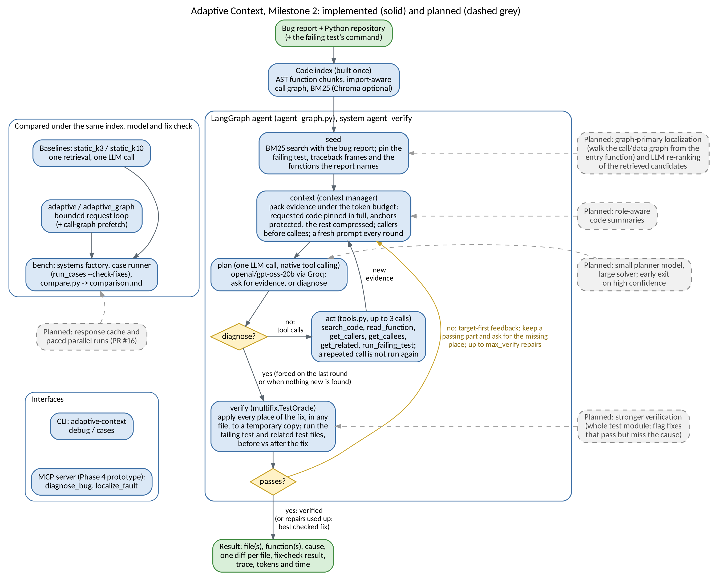

# Section 2 - Implemented Agentic System (Prem)

The system takes a Python repository and a bug report (and, when there is one, the command for the failing test)
and returns a diagnosis: the faulty file(s) and function(s), a cause grounded in code the model read, and a fix.
The Milestone 1 baseline did this with one retrieval and one model call. Milestone 2 turns that single shot into a
LangGraph agent that gathers evidence with tools, keeps its context under a token budget, and checks its own fix
against the tests.

**Workflow (input to output, Figure 1).**

1. **Index.** An AST chunker (`chunking.py`) splits the repository into function-level chunks, recording each
   chunk's path, qualified name and the names it calls. Import-aware resolution links a call site to the function it
   calls (`retrieval.py`). BM25 by default, Chroma optional.
2. **seed.** One BM25 search with the bug report, the same first step as the static baseline. The failing test,
   traceback frames and functions the report names are pinned.
3. **context.** The context manager packs the evidence pool under the token budget (`budget.py`, `compress.py`,
   `sequencing.py`): requested code is pinned in full, the entry function the report names is protected, and the rest
   is compressed and ordered callers before callees. Every round gets a fresh prompt with a short action history, so
   tool output does not pile up in a growing chat log.
4. **plan.** One LLM call with native tool calling. The model asks for evidence or calls `diagnose`. On the last
   round, or after a round that found nothing new, only `diagnose` is offered.
5. **act.** Up to three tool calls per round (`tools.py`): `search_code`, `read_function`, `get_callers`,
   `get_callees`, `get_related` (base and sibling implementations of a method, often in other files) and
   `run_failing_test`. A repeated call is not run again. The results go back to step 3.
6. **verify** (`agent_verify` only). `multifix.TestOracle` applies the whole fix, the main change plus every
   `other_changes` location in any file, to a temporary copy. It runs the failing test, then runs the related test
   files before and after the fix to catch regressions. Fixes written as a unified diff go through Tanay's
   `fixcheck.py` (Section 4).

The output is the diagnosis, the fix as one diff per file, the fix-check result, the trace of rounds and tool calls,
and token, call and time counts.

**Systems compared.** A single factory (`bench/systems.py`) builds every system from shared components, so the
comparison is controlled. The baselines are `static_k3` and `static_k10` (one retrieval at Top-3/Top-10, one model
call). The proposed systems are `adaptive` (bounded loop with compression, ordering and token budget),
`adaptive_graph` (the loop plus call-graph prefetch of a requested function's callees), `agent` (the LangGraph
tool-calling agent) and `agent_verify` (the agent plus the fix check and repair loop). The case runner can apply the
same fix check to every system's final fix after the run (`run_cases --check-fixes`), so the baselines are scored on
the same test outcome without getting feedback from it.

**Agentic mechanisms.**

- **Decision and planning:** each round the model decides whether it has enough evidence to diagnose, so the number
  of rounds is set at run time by the evidence, within the round limit and the token budget.
- **Tool use:** native function calling over the six tools. A malformed tool call is repaired or retried (up to two
  invalid replies) instead of ending the run.
- **State:** the LangGraph state carries the evidence pool, the pinned functions, the action history, the fix checks
  done so far and the best candidate.
- **Call-graph navigation:** import-aware resolution checks the same file, then the file's imports, before name
  matching, which lets the agent follow a multi-hop failure path instead of guessing from one search.
- **Verification and repair:** a failed fix check returns target-first feedback: first whether the failing test
  still fails, then tests the fix broke, names other files still use, and related tests that still fail (often the
  same defect in a sibling implementation). If the failing test passes but a related test still fails, the passing
  part is kept and the agent is asked for the missing place. Each failed check grants two more rounds, up to
  `max_verify` repairs (6 in Section 3.4), and the best checked fix is returned.

**Models and frameworks.** `openai/gpt-oss-20b` via Groq for all live comparison runs, and one separate run with
`openai/gpt-oss-120b` on the multi-file bug thefuck-16. A deterministic SimulatedLLM for offline runs and tests.
BM25 retriever by default, Chroma (all-MiniLM-L6-v2) optional. LangGraph for the agent. As a Phase 4 prototype, the
debugger is also exposed as an MCP server (`diagnose_bug`, `localize_fault`).

**Changes since Milestone 1.** The single retrieval became a bounded loop with call-graph navigation, and then a
LangGraph agent with native tool calling. The token budget now counts the whole prompt and never compresses a
requested or anchor function below a readable form (Section 5.1). Fixes can span several files: `diagnose` takes
`other_changes`, and the fix check applies and tests all places together, including related test files. One retry
after a failed check became a repair loop with feedback. A real-repository fix checker was added (Section 4).
Diagnoses with no file or function are rejected rather than counted valid, so the baseline is measured honestly.
The stakeholder's `payment_bug` and `auth_bug` became a test manifest, and a comparison pipeline
(`run_cases --check-fixes`, `bench/compare.py`, `scripts/run_comparison.sh`) produces Section 3.4.

**Figure 1.** Adaptive Context architecture as implemented for Milestone 2. Solid boxes run in the Milestone 2
evaluation; dashed grey boxes are planned for the next phases (`docs/PHASE4_PLAN.md`) and point at the stage they
change. Green = input and output, blue = implemented components, yellow = decisions: each round the agent either
diagnoses or calls tools, and a failed fix check loops back to the context with feedback. Source:
`docs/report/figures/architecture_m2.dot`.
