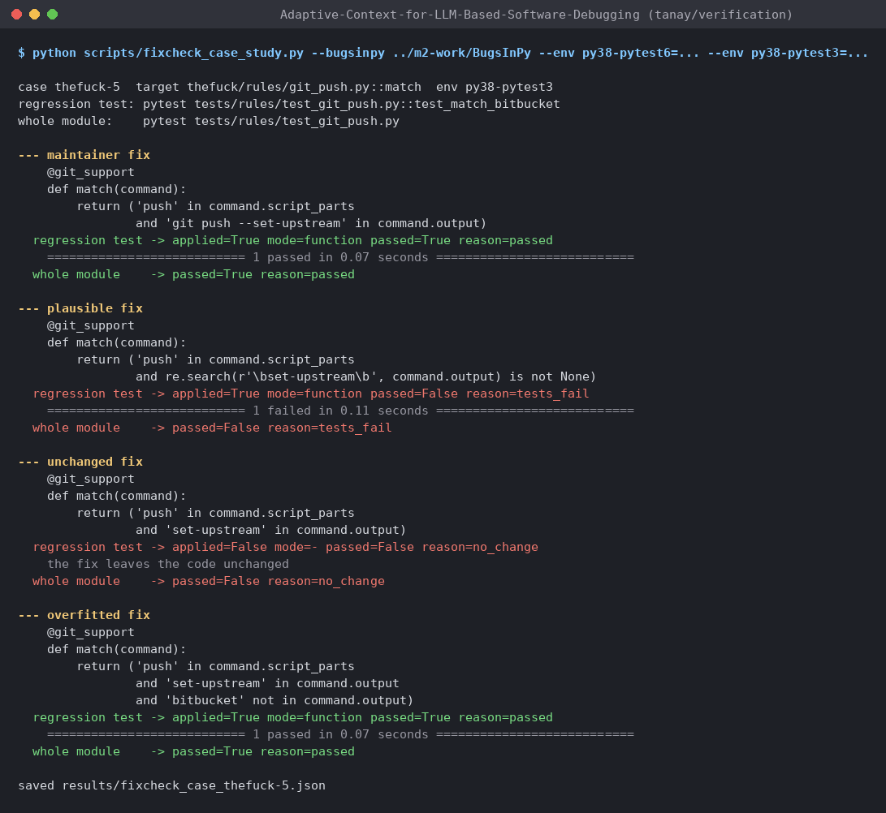

# Section 4, demo: checking a fix on a real bug (draft, Tanay)

No LLM is involved in this section. Every number comes from real test runs on dataset B (BugsInPy/thefuck),
produced at a clean commit: `results/fixcheck_validation.{json,jsonl,md}` (commit `4922e07`) and
`results/fixcheck_case_thefuck-5.{json,txt}` (commit `4775946`).

Reproduce (after `scripts/setup_env.sh`):

```bash
python -m adaptive_context.bench.audit --validate-fixcheck --bugsinpy ../m2-work/BugsInPy \
    --env py38-pytest6=../m2-work/venv38/bin/python --env py38-pytest3=../m2-work/venv38old/bin/python
python scripts/fixcheck_case_study.py --bugsinpy ../m2-work/BugsInPy \
    --env py38-pytest6=../m2-work/venv38/bin/python --env py38-pytest3=../m2-work/venv38old/bin/python
```

## What the fix check does

In Milestone 1 a fix could only be checked on the synthetic benchmark. For real bugs, `fixcheck.check_fix` takes
the model's diagnosis (file, function, fix), copies the repository to a temporary folder, applies the fix there,
and reruns the bug's failing test with the Python environment that the case needs. It returns
`{applied, mode, passed, reason, output}`. The `agent_verify` system calls it after every diagnosis. If the fix
fails, the agent gets the reason and the end of the test output, and it can try once more.

A model can write a fix in three shapes:

* a whole function that replaces the named one (found by its qualified name, e.g. `Fish.info`);
* imports followed by the function; the imports are added after the module's last import;
* one line that replaces the most similar line in the function.

Fixes that change several functions or module-level code are given as a unified diff. The check refuses paths
outside the repository and rejects fixes that do not parse or do not change the code (comments and whitespace
do not count as a change).

## Validation on all 32 real bugs

For each bug we wrote the maintainer's fix the way a model would. When the patch changes one function, the fix
is that fixed function, plus any imports the patch adds (22 bugs). For the other 10, the fix is the
maintainer's diff: 6 change several functions in one file, 2 change several files, and 2 change module-level code.
We only used the function form when applying it gives the maintainer's file back (same code; imports may sit in a
different place). As a negative control we resubmitted the buggy function unchanged. We also ran the same test on
the unchanged repository.

| Check | Result |
|---|---|
| Maintainer fix applies and the failing test passes | **32/32** (function form 22/22, diff form 10/10) |
| Unchanged buggy function is rejected (`no_change`) | **32/32** |
| Same test on the unchanged repository fails | **32/32** |
| Time per fix check (copy + patch + test run) | median 0.83 s, max 1.14 s |

Two bugs (thefuck-12 and thefuck-23) also exercise import hoisting on real code: the maintainer adds `which` to an
existing import line and inserts `closing` in the middle of the import block. Our fix adds the import after the
last one, which binds the same names, and the test passes.

## Case study: thefuck-5

The regression test `test_match_bitbucket` gives `git push` output from Bitbucket. That output contains the text
`set-upstream` inside a branch name (`feature/set-upstream`), so the old rule `'set-upstream' in command.output`
fires when it should not. We ran four fixes through `check_fix` (Figure X):

| Fix | What it does | Applied | Regression test | Whole test module |
|---|---|---|---|---|
| Maintainer | matches `'git push --set-upstream'` | yes (function) | **passed** | passed |
| Plausible but wrong | regex `\bset-upstream\b`, a reasonable guess | yes (function) | **tests_fail** | tests_fail |
| Unchanged | the buggy function resubmitted | no (`no_change`) | not run | not run |
| Overfitted | adds `'bitbucket' not in command.output` | yes (function) | **passed** | passed |

The plausible fix fails because a word boundary also matches between `/` and `set`. A diagnosis that only looks
right is caught here. The overfitted fix shows the limit of the check: it passes because the test only uses
Bitbucket output. Section 5 (Failure 2) discusses this.



*Figure X: terminal output of `scripts/fixcheck_case_study.py` on thefuck-5 (rendered from
`results/fixcheck_case_thefuck-5.txt`).*

Pending (with Karthik's live runs on merged `main`): the share of each system's final fixes that pass the fix
check. That number will come from the evaluation files and is not reported here yet.
